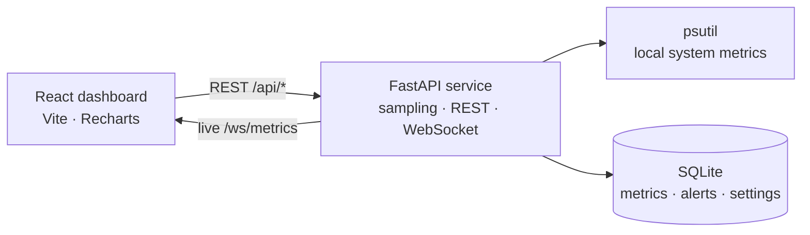

# PulseWatch

PulseWatch is a real-time, single-host system health dashboard. A Python service samples CPU, memory, disk, network, uptime, and host details, stores metrics in SQLite, and streams live updates to a React dashboard. Alert thresholds and metric retention can be adjusted in the UI.

The application source is in `pulsewatch/`; the Compose file, CI workflow, license, and this guide are at the repository root.

## Architecture



## Features

- Live CPU, memory, disk, network, and uptime monitoring
- Historical metric charts and host/system details
- Configurable alert thresholds with active/resolved alert history
- WebSocket updates with browser-side reconnect attempts
- SQLite persistence and configurable sample interval and retention
- FastAPI OpenAPI documentation at `/docs`

## Tech stack

- **Frontend:** React 18, Vite, Recharts, Tailwind CSS, Lucide
- **Backend:** Python 3.12+, FastAPI, Uvicorn, SQLAlchemy, Pydantic Settings, psutil
- **Storage:** SQLite
- **DevOps:** Docker Compose and GitHub Actions

## Windows prerequisites

- Windows 10/11 and PowerShell
- Python 3.12 or newer on `PATH`
- Node.js 20 LTS (includes npm)
- For the container option: Docker Desktop with the Compose v2 plugin, running Linux containers
- Git, if cloning the project

Verify the installed tools from PowerShell:

```powershell
py --version
node --version
npm --version
docker --version
docker compose version
```

Docker commands are optional when using native setup.

## Native setup

Open two PowerShell windows from the repository root.

### Backend

```powershell
Set-Location .\pulsewatch\backend
py -3.12 -m venv .venv
.\.venv\Scripts\Activate.ps1
python -m pip install --upgrade pip
python -m pip install -r requirements.txt
Copy-Item .env.example .env
python -m app
```

The API listens at `http://localhost:8000`. If PowerShell blocks virtual-environment activation, either allow it for the current process with `Set-ExecutionPolicy -Scope Process -ExecutionPolicy Bypass` or run commands using `.\.venv\Scripts\python.exe`.

### Frontend

In the second window:

```powershell
Set-Location .\pulsewatch\frontend
npm ci
Copy-Item .env.example .env
npm run dev
```

Open the Vite URL printed in the terminal (normally `http://localhost:5173`). The checked-in frontend service uses `VITE_API_URL` and `VITE_WS_URL`, defaulting to the local backend URLs shown in `.env.example`. Vite reads these values when it starts; restart the dev server after changing them.

## Docker Compose setup

From the repository root, copy the Compose environment example and start both services:

```powershell
Copy-Item .env.example .env
docker compose --env-file .env up --build
```

Open `http://localhost:5173`; the API is available at `http://localhost:8000`. The backend stores its SQLite database in the `pulsewatch-data` named volume. Stop the services with `Ctrl+C`, then run `docker compose down`. To also delete persisted database data, use `docker compose down --volumes`.

The frontend URLs are compiled into its static assets during the image build. Set `VITE_API_URL` and `VITE_WS_URL` to browser-reachable URLs before building if using non-default hostnames or ports. Compose port overrides are available through `BACKEND_PORT` and `FRONTEND_PORT` in `.env`.

**Docker on Windows limitation:** Docker Desktop runs Linux containers inside its Linux environment. In Compose mode, `psutil` reports the backend container/Linux environment rather than providing a complete view of the Windows host. For Windows host metrics, run the backend natively on Windows and use the containerized frontend or run both services natively. Docker image builds and container startup have not been verified in this environment.

## API documentation

Interactive OpenAPI documentation is available at `http://localhost:8000/docs` when the backend is running; the schema is at `/openapi.json`.

| Method | Path | Purpose |
| --- | --- | --- |
| `GET` | `/api/health` | API and database health |
| `GET` | `/api/system` | Hostname, OS, architecture, and Python version |
| `GET` | `/api/metrics/current` | Most recently collected metric; returns `503` until one is available |
| `GET` | `/api/metrics/history?limit=100` | Recent metric history (`limit` 1–1000, capped by configured retention) |
| `GET` | `/api/alerts?limit=100&active_only=false` | Recent alerts; `active_only=true` filters to active alerts |
| `GET` | `/api/settings` | Read alert and sampling settings |
| `PUT` | `/api/settings` | Update settings |
| WebSocket | `/ws/metrics` | Live metric messages as JSON with `type: "metrics"` and a `data` object |

Settings updates accept `cpu_threshold`, `memory_threshold`, and `disk_threshold` (0–100), `cooldown_seconds` (0–86400), `retention_count` (1–100000), and `sample_interval_seconds` (1–60).

## Tests and build

Run these commands from the repository root in PowerShell:

```powershell
Push-Location .\pulsewatch\backend
py -3.12 -m pip install -r requirements.txt
python -m pytest
Pop-Location

Push-Location .\pulsewatch\frontend
npm ci
npm test
npm run build
Pop-Location
```

The GitHub Actions workflow runs the backend tests and frontend tests/build on pushes and pull requests.

## Troubleshooting

- **Dashboard is offline:** confirm the backend is running and `http://localhost:8000/api/health` returns `{"status":"ok","database":"ok"}`. Check the `VITE_*` values and restart Vite if they changed.
- **WebSocket cannot connect:** confirm `VITE_WS_URL` uses `ws://` for local HTTP or `wss://` behind HTTPS, and that it ends with `/ws/metrics`.
- **Port already in use:** stop the process using the port or change `BACKEND_PORT` / `FRONTEND_PORT` in the root `.env` for Compose. For native runs, configure backend `PORT` in `pulsewatch\backend\.env` and pass a different Vite port, for example `npm run dev -- --port 5174`.
- **Python dependency or activation errors:** check `py --version`, recreate the backend `.venv` if it was created with another interpreter, or use its Python executable directly instead of activating it.
- **Docker Desktop errors:** make sure Docker Desktop has started and is set to Linux containers, then check `docker compose version` and port availability.

## Screenshots

No screenshots are included yet. Add genuine captures of the running application under `docs/screenshots/` and link them here; do not use mockups or generated images as product screenshots.

## Known limitations

- Monitoring is for the machine/container running the backend, not a fleet of remote hosts.
- SQLite and the single backend process are intended for local/demo usage, not high-availability or concurrent multi-instance deployment.
- The API does not include user authentication or authorization; do not expose it directly to an untrusted network.
- Docker Desktop Linux containers do not expose complete Windows host metrics to `psutil`.

## Future improvements

- Add authenticated access and role-based permissions.
- Support remote agents and a multi-host inventory.
- Add a production datastore and deployment/backup guidance.
- Add configurable notification integrations and alert delivery history.
- Add deployment-specific screenshots and end-to-end coverage.

## Interview explanation

PulseWatch separates the UI from a small monitoring API: the backend periodically samples system statistics with `psutil`, persists measurements and alert state with SQLAlchemy/SQLite, and exposes historical data over REST. A WebSocket broadcasts each new sample to the React client for near-live updates, while settings let a user control thresholds, sampling cadence, and retention. Compose and CI make the two application pieces easier to run and validate; the Docker-on-Windows host-metrics constraint is an intentional operational caveat.

## Resume bullets

Use only measurements and claims you can substantiate; replace bracketed fields with verified results:

- Built **PulseWatch**, a React/FastAPI system-health dashboard streaming CPU, memory, disk, and network metrics over WebSockets; implemented [verified feature or measured result].
- Implemented configurable alert thresholds, SQLite-backed metric history, and retention controls using SQLAlchemy; validated with [number] backend tests.
- Added Docker Compose and GitHub Actions workflows for the frontend and backend; achieved [verified CI/build outcome] across [verified environment(s)].
